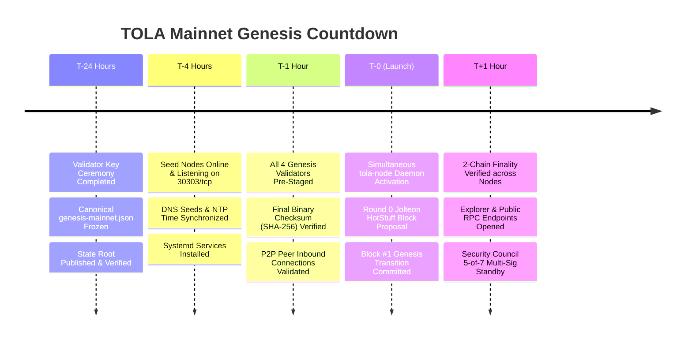

# TOLA Network: Canonical Mainnet Launch Runbook & Operational Playbook

**Document Identifier:** `TOLA-OPS-MAINNET-RUNBOOK-v1.0`  
**Network:** TOLA Mainnet (Chain ID `9999`)  
**Target Date / Epoch:** Mainnet Genesis $T_0$  
**Security Classification:** Public Operational Specification  

---

## 1. LAUNCH TIMELINE & PROCEDURE (T-24h to T+1h)



### Phase A: T-24 Hours — Genesis Freeze & State Root Attestation
1. Complete the air-gapped **Mainnet Genesis Key Ceremony** per `docs/deployment/mainnet-genesis-ceremony.md`.
2. Mix public verifiable Drand randomness into the genesis artifact:
   ```bash
   tola-cli ceremony drand-bind \
     --round 4250000 \
     --signature <DRAND_BLS_SIG_HEX> \
     --genesis genesis-mainnet.json \
     --output genesis-mainnet.json
   ```
3. Compute the canonical state root and SHA-256 checksum:
   ```bash
   tola-cli genesis show --file genesis-mainnet.json
   sha256sum genesis-mainnet.json
   ```
4. All 4 genesis validator organizations co-sign the cryptographic attestation document.

### Phase B: T-4 Hours — Node Infrastructure Pre-Staging
1. Node operators provision isolated bare-metal or cloud instances with Ubuntu 24.04 LTS.
2. Synchronize system clocks to NTP servers:
   ```bash
   timedatectl set-ntp on
   chronyc tracking
   ```
3. Open required ingress firewall ports:
   - `30303/tcp`: P2P Gossip & Consensus wire transport
   - `8545/tcp`: JSON-RPC (Private/Restricted for validators; open on public RPC gateways)
   - `9100/tcp`: Prometheus metrics scraper (Restricted to monitoring subnet)

### Phase C: T-1 Hour — Binary Verification & Service Configuration
1. Deploy release binary `tola-node` and verify SHA-256 checksum against official release assets.
2. Install the production systemd service unit file (see Section 2).
3. Verify validator Ed25519 consensus key is securely mounted from HSM or encrypted keyfile.

### Phase D: T-0 — Simultaneous Genesis Ignition
1. At timestamp $T_0$, start the service on all 4 genesis validator nodes:
   ```bash
   sudo systemctl start tola-node.service
   ```
2. Validators establish mutual TCP connections, begin pacemaker round 0, elect the genesis leader, and ingest Block #1.

### Phase E: T+1 Hour — Cluster Health Attestation & Public Opening
1. Verify height progression and QC finality:
   ```bash
   tola-cli node health --rpc-url http://127.0.0.1:8545
   ```
2. Confirm identical JMT state roots across all validator databases.
3. Open public load-balanced JSON-RPC gateways and connect the TOLA Block Explorer.

---

## 2. PRODUCTION SYSTEMD SERVICE CONFIGURATION

Create `/etc/systemd/system/tola-node.service`:

```ini
[Unit]
Description=TOLA Network Mainnet Validator Daemon
After=network-online.target time-sync.target
Wants=network-online.target time-sync.target

[Service]
Type=simple
User=tola
Group=tola
WorkingDirectory=/var/lib/tola
LimitNOFILE=65536
LimitNPROC=32768
Restart=always
RestartSec=5s

ExecStart=/usr/local/bin/tola-node \
    --chain-id 9999 \
    --data-dir /var/lib/tola/data \
    --p2p-addr 0.0.0.0:30303 \
    --rpc-addr 127.0.0.1:8545 \
    --validator \
    --validator-key ${VALIDATOR_CONSENSUS_KEY_HEX} \
    --genesis /etc/tola/genesis-mainnet.json \
    --bootstrap-peer 198.51.100.1:30303 \
    --bootstrap-peer 198.51.100.2:30303 \
    --bootstrap-peer 198.51.100.3:30303 \
    --log-level info

# Sandboxing & Security Hardening
ProtectSystem=strict
ProtectHome=true
ReadWritePaths=/var/lib/tola
PrivateTmp=true
ProtectKernelTunables=true
ProtectControlGroups=true
NoNewPrivileges=true

[Install]
WantedBy=multi-user.target
```

---

## 3. FIREWALL & NETWORK SECURITY (UFW RULES)

```bash
# Default policies
sudo ufw default deny incoming
sudo ufw default allow outgoing

# SSH management (restrict to VPN / Bastion IP)
sudo ufw allow from 203.0.113.50 to any port 22 proto tcp

# P2P Network (Publicly accessible for gossip & sync)
sudo ufw allow 30303/tcp comment "TOLA P2P Wire Transport"

# Monitoring (Restricted to Prometheus scraper)
sudo ufw allow from 10.10.0.5 to any port 9100 proto tcp comment "Prometheus Metrics"

# JSON-RPC (Localhost only for validator nodes; reverse-proxied with rate-limiting on gateways)
# Do NOT open 8545 publicly on block producer nodes!
sudo ufw enable
```

---

## 4. PROMETHEUS & GRAFANA MONITORING SPECIFICATION

Each node exposes metrics on `/metrics` (or port 8545). Essential Prometheus alerts:

```yaml
groups:
  - name: tola-mainnet-alerts
    rules:
      - alert: TolaValidatorDowntime
        expr: increase(tola_block_height[2m]) == 0
        for: 1m
        labels:
          severity: critical
        annotations:
          summary: "TOLA Validator node is not advancing block height"

      - alert: TolaPeerCountLow
        expr: tola_p2p_connected_peers < 3
        for: 3m
        labels:
          severity: warning
        annotations:
          summary: "TOLA Validator has fewer than 3 connected peers"

      - alert: TolaStateRootDivergence
        expr: count by (tola_block_height) (count by (tola_state_root) (tola_state_root)) > 1
        for: 30s
        labels:
          severity: critical
        annotations:
          summary: "CRITICAL: State root divergence detected between validators!"
```

---

## 5. INCIDENT RESPONSE & EMERGENCY CONTACTS

In the event of an unrecoverable consensus halt or critical zero-day exploit:
1. **Quorum Halt Protection:** If $\ge 2$ validators pause, finality halts automatically to preserve state integrity.
2. **Community Security Council Contact:** Immediately notify the 5-of-7 council to review emergency pause logs.
3. **Rollback Snapshot:** Do not delete `/var/lib/tola/data/state` without creating an atomic copy.
