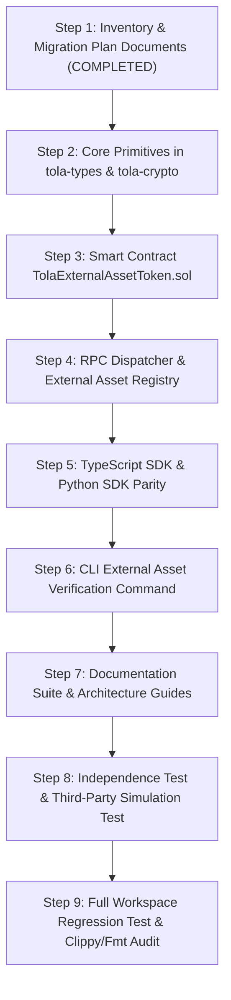

# TOLA NETWORK — ARCHITECTURE MIGRATION PLAN: EXTERNAL ASSET TOKENIZATION

**Document ID:** ARCH-MIG-PLAN-001  
**Date:** October 7, 2026  
**Status:** APPROVED FOR IMPLEMENTATION  
**Author:** Lead Protocol Architect, Blockchain Engineer, Security Engineer & QA Lead  

---

## 1. Migration Purpose & Core Architectural Principles

This migration addresses an architectural ambiguity in the ecosystem layer where external messenger identities (such as PaxtaGram usernames, phone numbers, or external gifts) were previously in danger of being conflated with native TOLA blockchain identities.

### Non-Negotiable Architectural Principles:
1. **Total System Independence:** TOLA and PaxtaGram are completely independent platforms. The TOLA blockchain node never connects to, authenticates against, queries, or depends on PaxtaGram APIs, servers, or databases.
2. **Three Sovereign Asset Concepts:**
   - **TOLA Native Asset:** Sovereign on-chain assets created directly on TOLA (e.g. TOLA Native Usernames, TOLA Native Gifts `TGIFT`). TOLA is the absolute source of truth.
   - **External Asset:** Assets created and owned entirely within an external platform (e.g. PaxtaGram username `@anvar`, PaxtaGram Gifts Number `#10001`, external messenger gift). The external platform is the sole source of truth. TOLA does NOT create or govern these.
   - **Tokenized External Asset:** A TOLA NFT (TLS-721) minted on TOLA that represents an external asset. Minted via an independent third-party tokenization application (e.g., Fragment-like service) after off-chain verification. TOLA NFT ownership represents blockchain ownership of the representation, NOT automatic legal control of the original external asset.
3. **Third-Party Tokenizer Boundary:** The third-party integration application is the sole boundary between the external platform and TOLA Network. TOLA core consensus is isolated from external business logic.

---

## 2. Component Migration Plan Matrix

### 2.1 Identity & Usernames

| Dimension | Specification |
|---|---|
| **Old Behavior** | `@username` registry had ambiguous scope, potentially implying on-chain ownership of external messenger handles. |
| **New Behavior** | Explicitly defined as **TOLA Native Username**. Independent of any external messenger handle. If a user holds `@anvar` on TOLA and `@anvar` on PaxtaGram, these are coincidentally equal strings with zero automated linking. |
| **Migration Method** | Keep existing `Username` struct, pricing tiers, commit-reveal, and RPC handlers (`tola_resolveUsername`). Update documentation and code comments to strictly declare sovereign TOLA-native status. Introduce `ExternalAssetType::MessengerUsername` for tokenized external usernames. |
| **Compatibility Impact** | Zero breaking changes to existing native username registration, resolution, or contract interfaces. |
| **Test Coverage** | Existing username validation and commit-reveal tests retained. New test vectors added proving independence from external handles. |
| **Rollback Consideration** | Reverting documentation requires no state or storage migration. |

---

### 2.2 Digital Gifts, Collectibles & External Assets

| Dimension | Specification |
|---|---|
| **Old Behavior** | TLS-721 gifts had a single badge attestation linking on-chain tokens to `messenger_id`. No generic model for tokenizing external platform gifts or numbers. |
| **New Behavior** | Strict separation:  1. **TOLA Native Gift (`TGIFT`)**: Limited edition collectibles natively minted and transferred on TOLA.  2. **Tokenized External Asset**: Canonical TLS-721 token representing verified external assets (usernames, Gifts Numbers, external gifts) with deterministic canonical identity, verifier attestation, and anti-replay protection. |
| **Migration Method** | Retain `TolaDigitalGift.sol` and legacy badge attestations for backward compatibility. Add generic Rust types (`ExternalAssetType`, `ExternalAssetSource`, `ExternalAsset`, `ExternalAssetAttestation`), cryptographic digests, RPC endpoints, and SDK modules (`external/asset.js`, `tola/external.py`). Add `TolaExternalAssetToken.sol`. |
| **Compatibility Impact** | Fully backward compatible. Legacy profile badge methods continue to function. |
| **Test Coverage** | Unit tests in `tola-types`, `tola-crypto`, `tola-rpc`, TypeScript SDK, and Python SDK covering attestation verification, replay rejection, duplicate mint prevention, and cross-language parity. |
| **Rollback Consideration** | New types are additive; rollback involves deprecating new endpoints without impacting existing native gifts. |

---

### 2.3 Client-Side Bridge & TOLA Connect

| Dimension | Specification |
|---|---|
| **Old Behavior** | `TelegramMiniAppBridge` in TypeScript SDK gave the impression of specific messenger coupling, although it implemented generic clear-signing. |
| **New Behavior** | Renamed to **`MiniAppBridge`** (generic webview bridge for any third-party app or tokenizer). `TelegramMiniAppBridge` retained as an extending subclass alias for backward compatibility. |
| **Migration Method** | Export `MiniAppBridge` as primary class in `sdk/typescript/src/connect/bridge.js`, with `export class TelegramMiniAppBridge extends MiniAppBridge`. |
| **Compatibility Impact** | 100% backward compatible for any client code importing `TelegramMiniAppBridge`. |
| **Test Coverage** | Tests verified for both `MiniAppBridge` and `TelegramMiniAppBridge`. |
| **Rollback Consideration** | Purely additive wrapper; trivial rollback if needed. |

---

### 2.4 JSON-RPC Interface

| Dimension | Specification |
|---|---|
| **Old Behavior** | RPC exposed only native username resolution and gift details. No endpoints for querying tokenized external assets. |
| **New Behavior** | Expose sovereign blockchain state only:  - `tola_getExternalAsset`: Query external asset by token ID or canonical hash  - `tola_getExternalAssetOwner`: Query TOLA address owning the external asset NFT  - `tola_getExternalAssetMetadata`: Query metadata URI and platform reference  - `tola_verifyExternalAssetAttestation`: Cryptographically verify third-party tokenization attestation prior to minting.  *(Strict prohibition on `/get_paxtagram_username` or node querying external APIs).* |
| **Migration Method** | Implement new dispatch methods in `crates/tola-rpc/src/dispatcher.rs` backed by `external_asset_registry`. |
| **Compatibility Impact** | Purely additive. Existing `tola_resolveUsername` and `tola_getGiftDetails` remain intact. |
| **Test Coverage** | Comprehensive RPC unit tests and live HTTP integration tests against running node daemon. |
| **Rollback Consideration** | Remove new method branches in dispatcher if rolled back; no underlying database schema corruption. |

---

### 2.5 Cross-Language SDKs (Rust, TypeScript, Python)

| Dimension | Specification |
|---|---|
| **Old Behavior** | No external asset tokenization modules in SDKs. |
| **New Behavior** | Bit-for-bit parity across Rust (`crates/tola-types`, `crates/tola-crypto`), TypeScript (`@tola/sdk/external`), and Python (`tola.external`):  - `ExternalAssetType` enum  - `computeExternalAssetAttestationDigest`  - `signExternalAssetAttestation`  - `verifyExternalAssetAttestation`  - `computeExternalAssetCanonicalId` |
| **Migration Method** | Implement dedicated modules in TypeScript and Python, export via package entry points, and add comprehensive cross-SDK test vectors. |
| **Compatibility Impact** | Non-breaking. All existing wallet, transaction, memo, and connect APIs preserved. |
| **Test Coverage** | 100% test pass rate with parity test suites across Node.js and Python test runners. |
| **Rollback Consideration** | Deprecate new exports if rolled back. |

---

## 3. Safe Implementation Phases

The migration will execute strictly in the following sequential phases:

---

## 4. Phase 19 Non-Regression & Isolation Verification

- **Invariant:** Phase 19 (`ADR-0014`, Cross-Shard State Proofs, Inter-Rollup State Bridge, Shard IDs, Receipts, Coordination Blocks) remains strictly frozen.
- **Verification:** Pre-migration and post-migration `git diff` checks will guarantee zero unintended edits to Phase 19 files.
- All Phase 19 automated tests must continue passing with zero regressions.

---

## 5. Security & Privacy Safeguards During Migration

1. **Anti-Replay Protection:** Attestations must cryptographically bind `chainId`, `destination_wallet`, `nonce`, and `expires_at`.
2. **Duplicate Mint Prevention:** Canonical hash `keccak256(source_platform || ":" || asset_type || ":" || external_asset_id)` uniquely identifies external assets on-chain, preventing multiple NFTs for a single external asset.
3. **Zero Sensitive PII on-chain:** Phone numbers and private messenger credentials must never be written to on-chain state; only opaque identifiers and content hashes are stored.
4. **Ownership Decoupling:** Transfer of a TOLA NFT changes only the on-chain ownership; it does NOT trigger any automated or implicit changes on the external platform.
